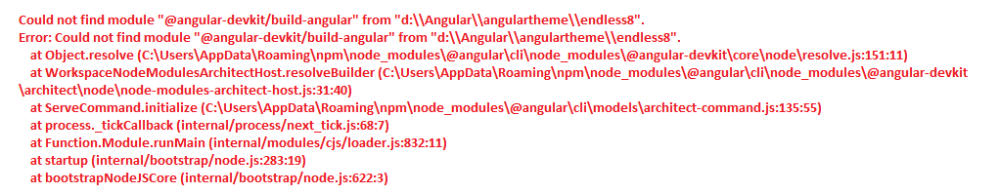
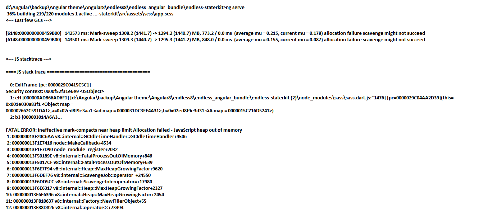
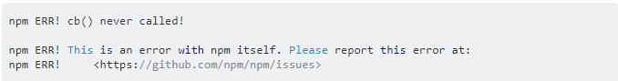
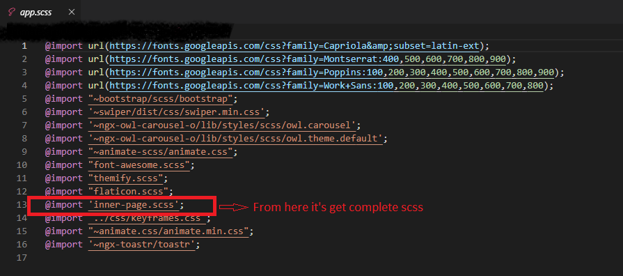

# EMAC

École militaire des aspirants de Coëtquidan.
Première version du site de l'EMAC.

Ce site permet l'affichage d'informations concernant :

- l'EMAC
- les promotions de l'EMAC

## Contribuer

Afin de contribuer :

1. Créer une branche à partir de `main`.
2. Effectuer les modifications sur la nouvelle branche.
3. Créer une PR (pull request) de votre branche sur `main`.
4. Une fois la PR `review` et `merged`, la nouvelle version est déployée automatiquement sur le serveur de production.

## Gestion des promotions avec Pages CMS

Les responsables gèrent les promotions depuis [Pages CMS](https://app.pagescms.org),
avec des formulaires pour les dates, les textes, les images, les galeries et les
chants. Les modifications sont enregistrées dans GitHub ; après une modification
sur `main`, GitHub Actions vérifie le contenu, reconstruit le site et le publie.
La mise en ligne prend le temps du workflow. En cas de validation ou compilation
incorrecte, le déploiement est interrompu et le site publié reste disponible.

### Connexion initiale par un administrateur

1. Publier ces fichiers sur le dépôt GitHub `lucianoBrd/emac`.
2. Ouvrir [app.pagescms.org](https://app.pagescms.org) et se connecter avec GitHub.
3. Installer l'application GitHub Pages CMS sur le compte propriétaire, en
   sélectionnant le dépôt `emac`.
4. Ouvrir le dépôt et choisir la branche `main`. Pages CMS lit automatiquement
   la configuration `.pages.yml`.
5. Donner accès aux responsables autorisés via les permissions GitHub ou les
   [collaborateurs Pages CMS](https://pagescms.org/docs/configuration/collaborators/).

Cette connexion doit être effectuée avec le compte du propriétaire du dépôt.
Aucun jeton GitHub n'est ajouté aux fichiers publics du site.
Voir le [guide officiel de connexion](https://pagescms.org/docs/quick-start/).

### Ajouter ou modifier une promotion

1. Dans **Promotions**, ouvrir une fiche ou créer une nouvelle entrée.
2. À la création, choisir un nom de fichier stable, par exemple
   `capitaine-exemple.json` : minuscules, chiffres et tirets uniquement.
   Ce nom détermine l'URL `/promotions/capitaine-exemple/`.
3. Renseigner le nom, le numéro unique, les dates et l'insigne. Les dates sont
   enregistrées sous la forme `YYYY-MM-DD`.
4. Ajouter les paragraphes avec l'éditeur de texte mis en forme. Compléter au
   besoin les sections facultatives : bannière, insigne, chant, album, galerie,
   réseaux sociaux et décorations.
5. Pour une galerie, choisir **Photo**, **Vidéo locale** ou **YouTube**. Pour
   YouTube, saisir un lien `https://www.youtube.com/embed/IDENTIFIANT` et sa miniature.
6. Cocher **Publier sur le site** et enregistrer pour mettre en ligne. Une nouvelle
   fiche est un brouillon par défaut ; elle peut être complétée avant publication.
7. Vérifier le workflow dans l'onglet **Actions** du dépôt.

Les identifiants techniques, les titres communs et les références aux images sont
générés automatiquement. Le menu, les pages prérendues et le sitemap suivent les
promotions publiées. Les noms de fichiers ne peuvent pas être renommés depuis le
CMS, afin de conserver les URL. La suppression y est désactivée ; décocher
**Publier sur le site** retire une fiche du site, avec une réponse 404 sur son
ancienne URL. Conserver au moins une promotion publiée.

Les médias sont rangés dans `public/assets/images` et `public/assets/music`.
La configuration accepte les images, vidéos locales et fichiers audio selon le
champ utilisé. Une validation contrôle les fichiers manquants, leur format et
la casse des noms avant publication.

### Organisation pour les développeurs

- `content/promotions/*.json` : une fiche par promotion, source du contenu.
- `.pages.yml` : formulaires, médias et droits de modification dans Pages CMS.
- `scripts/generate-promotions.mjs` : validation et adaptation aux modèles Angular.
- `src/app/shared/data/promotions.generated.json` : fichier généré et ignoré par Git.
- `src/app/shared/data/promotion.ts` : chargement et conversion des dates.
- `src/app/shared/models` : modèles des composants.

`npm install` / `npm ci` et `npm run build` génèrent automatiquement les données.
`npm start` et `npm run watch` surveillent les fichiers de contenu ; une
modification valide est rechargée, une modification invalide est signalée dans le
terminal en conservant la dernière version valide. Pour générer manuellement :
`npm run content:generate`. Pour les tests de validation : `npm run test:content`.
La configuration des formulaires est aussi la source de validation des champs.

# Developer guide

This project was generated using [Angular CLI](https://github.com/angular/angular-cli) version 20.2.1.

## Development server

To start a local development server, run:

```bash
npm start
```

Once the server is running, open your browser and navigate to `http://localhost:4200/`. The application will automatically reload whenever you modify any of the source files.

## Code scaffolding

Angular CLI includes powerful code scaffolding tools. To generate a new component, run:

```bash
ng generate component component-name
```

For a complete list of available schematics (such as `components`, `directives`, or `pipes`), run:

```bash
ng generate --help
```

## Building

To build the project run:

```bash
npm run build
```

This will compile your project and store the build artifacts in the `dist/` directory. By default, the production build optimizes your application for performance and speed.

## Running unit tests

To execute unit tests with the [Karma](https://karma-runner.github.io) test runner, use the following command:

```bash
ng test
```

## Running end-to-end tests

For end-to-end (e2e) testing, run:

```bash
ng e2e
```

Angular CLI does not come with an end-to-end testing framework by default. You can choose one that suits your needs.

## Additional Resources

For more information on using the Angular CLI, including detailed command references, visit the [Angular CLI Overview and Command Reference](https://angular.dev/tools/cli) page.

## Deploy

```bash
npm run github-build
npm run github-deploy
```

# Documentation

- SEO friendly structure and Without Jquery. The code written is a clean and well structured.
- Powerful & responsive theme with all the modules and functions involved with an attractive design.
- **Angular 20, ngbootstrap, HTML5, CSS3, scss and many more..**

### Getting started

Welcome to Angular! Angular helps you build modern applications for the web, mobile, or desktop.

For getting started an Angular application you needs two things as Prerequisites.

##### Prerequisites

Before you begin, make sure your development environment includes **Node** and an **npm package manager.**

##### Node.js

Download latest stable version of node.js i.e. 20.19.0 from [**nodejs.org.**](http://nodejs.org)

- Install Node.js using downloaded file
- To check your node version, run **node -v** in a terminal/console window.

##### Npm package manager

Angular CLI, and Angular apps depend on features and functionality provided by libraries that are available as npm packages. To download and install npm packages, you must have an npm package manager. This Quick Start uses the npm client command line interface, which is installed with Node.js by default. To check that you have the npm client installed, run **npm -v** in a terminal/console window.

For better understanding angular we suggest you to once go through official documentation of an Angular from [**angular.dev**](https://angular.dev/)

### Angular setup

##### Installing Angular CLI

You use the Angular CLI to create projects, generate application and library code, and perform a variety of ongoing development tasks such as testing, bundling, and deployment.

Install the Angular CLI globally.

To install the CLI using npm, open a terminal/console window and enter the following command:

`npm install -g @angular/cli`

### EMAC setup

If you have already download and install node.js and Angular CLI then ignore prerequisites accordingly.

##### Prerequisites

###### Node.js

Download stable version of node.js from [**nodejs.org.**](http://nodejs.org)

- Install Node.js using downloaded file
- To check your node version, run **node -v** in a terminal/console window.

###### Angular CLI

Install Angular CLI Using:

`npm install -g @angular/cli`

##### Setup EMAC project by

- **1) Clone EMAC project from GitHub**
- **2) Import all dependency by installing npm command**
  `npm install`
- **3) Now you are in stage to successfully run EMAC using below command:**
  `ng serve`

### Common issue

##### A common issue which user face during setup

- **1) If you had not doing "npm i" command for installing all dependencies and directly run "ng serve" command you may have following error**



**Solution:**

`npm install`

- **2) when running command using "ng serve" you may get sass error as below:**



**Solution:**

`npm install node-sass --save-dev`

- **2) Some times you also may get below error when running "ng serve"**



**Solution:**

`sudo npm cache clean`

### Folder Structured

Here we represent Angular Folder Structure and Style Customize

- EMAC

  - public
    - assets
      - css
      - fonts
      - images
      - pace
      - scss
      - .gitkeep
    - CNAME
    - sitemap.xml

  - src
    - app
      - emac
      - maintenance
      - page-not-found
      - promotions
      - shared
      - app.html
      - app.scss
      - app.ts
      - app.config.ts
      - app.routes.ts
    - index.html
    - main.ts
    - style.scss
  - angular.json
  - package.json
  - tsconfig.json

### SCSS and CSS Structure

We have build complete theme in scss so as end user select particular layout they have to change in below file:



Now as per our needed layout we are dynamically add that particular css

### Customization

#### Menu

Horizontal Menu

You can get horizontal menu from shared -> components -> navigation -> menu. export that components from shared module and use it using selector where you want to use that horizontal menu.

Center Logo menu

You can also get center menu from shared -> components -> navigation -> center-menu. export that components from shared module and use it using selector where you want to use that center logo menu.

For Mobile Responsive it emable using toggle bar in responsive screen

### Dark & RTL

#### Unice Angular come with two new features

- Dark

  If you want to use dark then you just need to add **<body class="dark">** in index.html at src root.

- RTL

  If you want to use RTL then you just need to add **<body class="rtl">** in index.html at src root.

- ##### **Main Theme**

  We have make one config file in main theme called **shared >> data >> config.ts** from where you can pass your default conflict like you want LTR or RTL and Dark or Light layout.

  Also, all text is defined in this file.

  That you can set from that config.ts

### Dependencies

- **Bootstrap** : Doc: https://ng-bootstrap.github.io/#/home
- **Ngx-toastr** : Doc: https://www.npmjs.com/package/ngx-toastr
- **Gallery** : Doc: https://www.npmjs.com/package/@ks89/angular-modal-gallery
- **Masonary Gallery** : Doc: https://www.npmjs.com/package/ngx-masonry
- **Ngx-rangeslider** : Doc: https://www.npmjs.com/package/ngx-rangeslider-component
- **Carousel** : Doc: https://www.npmjs.com/package/ngx-owl-carousel-o

### Thank you

Once again thank you for contribute of the EMAC project
-------------------------------------------------------

##### Best Regards, LucianoBrd

## SEO et publication statique

`npm run build` prérend les pages Angular, puis génère `sitemap.xml`,
`robots.txt` et `404.html` dans `dist/emac/browser` pour GitHub Pages.
Les pages des promotions et leurs galeries sont déduites de `PromotionDB.list`.
Une galerie vide ne produit pas de page indexable.

Chaque page possède son contenu HTML, son titre, sa description, son URL canonique
avec slash final et ses métadonnées de partage. Les pages d'erreur portent `noindex`.
GitHub Pages sert `404.html` avec un statut HTTP 404 pour les chemins inexistants.
Le déploiement utilise `--no-notfound` pour conserver cette page personnalisée.

`npm run generate-mpa` reste disponible pour régénérer les fichiers SEO après
une compilation ; cette commande ne copie plus l'accueil sur les autres pages.
Le dossier historique `seo-builder` n'est plus utilisé par la compilation.
Pour changer de domaine, mettre à jour `SITE_URL` dans `meta.service.ts` et
`base` dans `scripts/finalize-static.mjs`.

## Application web progressive (PWA)

Le site peut être installé depuis le menu du navigateur sur les appareils compatibles.
Sur iPhone ou iPad, ouvrir le site dans Safari, puis utiliser **Partager > Sur l'écran d'accueil**.
L'application s'ouvre ensuite dans une fenêtre autonome avec son icône EMAC.
L'installation et le service worker nécessitent HTTPS en production ; localhost est
accepté pour les essais.

Le service worker Angular est activé uniquement en production. Il précharge
le code de l'application et conserve les images et polices locales au fil des
consultations. Après une première visite en ligne et l'installation du cache,
les pages peuvent être ouvertes hors connexion. Les images jamais consultées,
les polices Google, les vidéos et les contenus externes ne sont pas garantis hors
connexion. Les vidéos ne sont pas mises en cache.

### Chants disponibles hors connexion

La lecture d'un chant en ligne déclenche sa mise en cache complète en arrière-plan,
sans attendre le téléchargement pour commencer l'écoute. Ouvrir un album seul
ne télécharge pas ses morceaux. Le chant devient disponible hors connexion une
fois son téléchargement terminé ; une écoute très brève suivie d'une coupure
réseau peut ne pas suffire.

Le cache audio est limité à **80 Mio**, **20 morceaux** et **20 Mio par morceau**.
Les morceaux les moins récemment utilisés sont supprimés en premier lorsque la
limite est atteinte. Les fichiers expirent après **30 jours**. Seuls les fichiers
audio complets du dossier local `assets/music` sont conservés ; les réponses HTTP
partielles (`206`) et les fichiers externes sont exclus.

Les chants en cache sont lus depuis une URL `blob:` locale : le navigateur gère
la lecture et le déplacement dans le morceau hors connexion. Le cache est distinct
du préchargement PWA et ne télécharge aucun album lors de l'installation.
Le navigateur peut libérer ce stockage ; une erreur de quota n'empêche pas la
lecture en ligne. Les limites se règlent dans `AUDIO_CACHE_LIMITS`, dans
`src/app/shared/service/audio-cache.ts`.

### Navigation et essais

Les navigations utilisent la stratégie `freshness` : en ligne, les pages HTML
prérendues sont demandées au serveur pour conserver le comportement SEO ; hors
connexion, l'application utilise son cache. Les erreurs 404 et la maintenance
sont exclues du repli de navigation. Le navigateur recherche automatiquement les
mises à jour ; les onglets déjà ouverts peuvent conserver leur version jusqu'à
leur fermeture et leur réouverture.

Pour tester, exécuter `npm run build`, puis servir `dist/emac/browser` avec un
serveur HTTP local. Dans les outils de développement du navigateur, vérifier
**Application > Manifest / Service Workers**, attendre l'activation du service
worker, puis tester une navigation avec le réseau désactivé. `npm start` utilise
la configuration de développement sans service worker.

La configuration du cache se trouve dans `ngsw-config.json`, le manifeste dans
`public/manifest.webmanifest` et les icônes dans `public/icons`.

Pour vérifier le cache audio : `npm run test:audio` contrôle les limites, l'expiration,
les téléchargements concurrents et le rejet des réponses incomplètes. Dans le
navigateur, lancer un chant en ligne, attendre son apparition dans
**Application > Cache Storage > emac-audio-v1**, puis recharger la page hors
connexion et relancer le chant, y compris en déplaçant la barre de progression.
